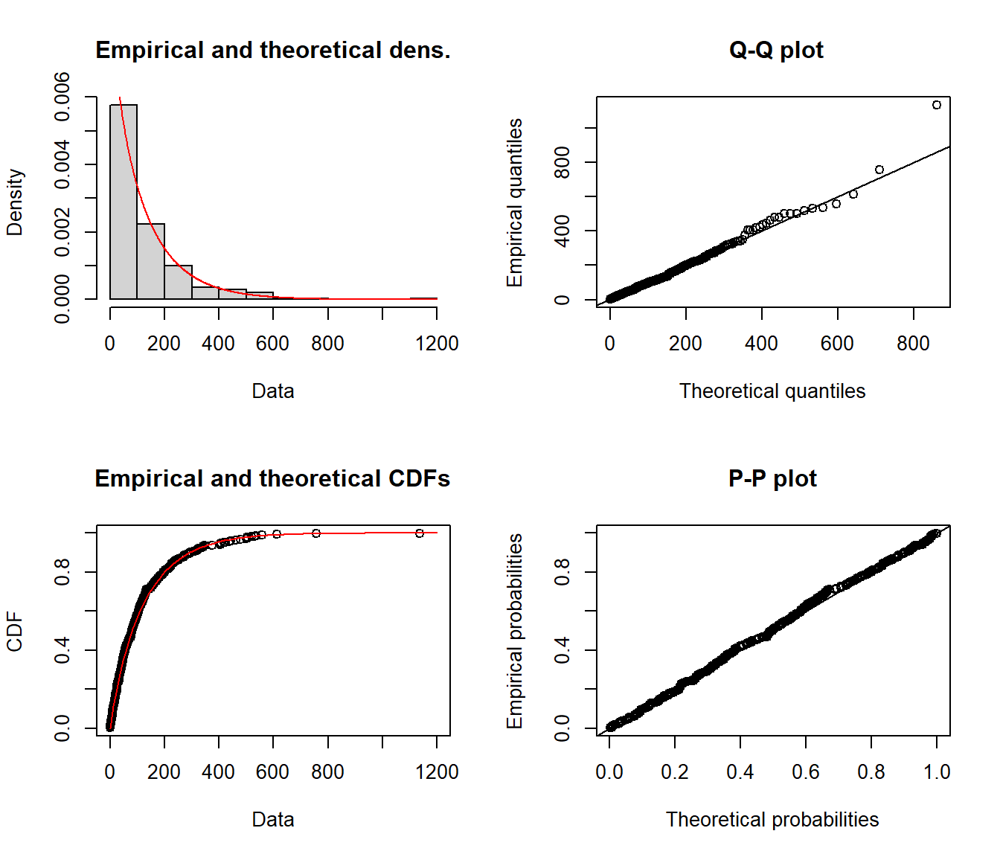

# Gangneung Rainfall Analysis

This master's-level coursework project examines monthly precipitation in Gangneung, South Korea. I used a single-station time series to study seasonality and identify months with unusually low or high rainfall for their time of year.

## Data

The course CSV contains 331 monthly totals in millimeters from January 1998 through September 2025. December 2022 and February 2025 have no records. Two observed months have zero precipitation. The report parses the Korean year-month labels, converts rainfall to numeric values, drops invalid records, and sums entries by calendar month. See the [data instructions](data/) for the exact input file.

## Methods

1. Plot the series and compare monthly distributions. Examine autocorrelation and partial autocorrelation.
2. Search seasonal ARIMA orders by AIC using maximum likelihood. Inspect the original report's selected ARIMA(2,0,2)(0,1,1)[12] model separately. Also search ARMA orders with 12 calendar-month indicators and inspect residual correlation and normality.
3. Fit a Gamma distribution by maximum likelihood to the 329 positive totals. Assess fit with density, Q–Q, CDF, and P–P plots and report goodness-of-fit statistics.
4. Fit a Gamma GLM with a log link and a categorical month effect. Divide each deviance residual by the square root of the estimated dispersion times one minus the observation's leverage. Flag values outside ±1.96 as an exploratory screen. The cutoff uses a normal reference and is unadjusted for screening many months.

The portfolio report leaves missing months as `NA` on the ARIMA calendar. The original coursework sometimes put successive observations in successive time slots even when a month was missing. Calendar alignment can therefore change the ARIMA fits and diagnostics. The Gamma fits still use the original positive observations. The Gamma residual ACF uses their observation order.

## Results

The month-specific regression flagged 17 low and 4 high observations. For example, December 2005 had 0.1 mm of rainfall, compared with a fitted mean of 35.7 mm and a standardized deviance residual of −3.70. These values were cross-checked directly from the archived data and agree with the coursework presentation. The figure is from the original submission.



The [original residual-flag plot](figures/residual-flags.png) shows both tails against the rainfall series.

## How to run

From this project directory, install R and Pandoc, put the CSV in `data/` as instructed, and run:

```sh
Rscript -e 'install.packages(c("rmarkdown","knitr","readr","dplyr","lubridate","stringr","ggplot2","fitdistrplus","forecast","tseries","nortest","gridExtra","tibble","zoo"), repos="https://cloud.r-project.org")'
Rscript -e 'rmarkdown::render("rainfall.Rmd")'
```

The report creates `rainfall.html` with data summaries, model fits, and diagnostics. The revised R Markdown was reviewed statically. The full report has not been rerun.

## Original source

The [Week 16 R Markdown](https://github.com/Taenyoung-Lee/assignments/blob/8691d9023612b2067f38c376081a185ce3e9064a/time_series_analysis/week16/Timeseries_%EA%B0%95%EB%A6%89%EA%B0%95%EC%88%98%EB%9F%89_final.Rmd) contains all preprocessing and model code used here. Earlier versions were reviewed to trace the inputs. The working CSV was found in [Week 6](https://github.com/Taenyoung-Lee/assignments/blob/8691d9023612b2067f38c376081a185ce3e9064a/time_series_analysis/week6/%EA%B0%95%EB%A6%89%EA%B0%95%EC%88%98%EB%9F%89_s.csv) and [Week 8](https://github.com/Taenyoung-Lee/assignments/blob/8691d9023612b2067f38c376081a185ce3e9064a/time_series_analysis/week8/%EA%B0%95%EB%A6%89%EA%B0%95%EC%88%98%EB%9F%89_s.csv), where GitHub reports identical file contents. The [portfolio report](rainfall.Rmd) omits a separate descriptive wildfire comparison and replaces a local Windows path with a project-relative path.
